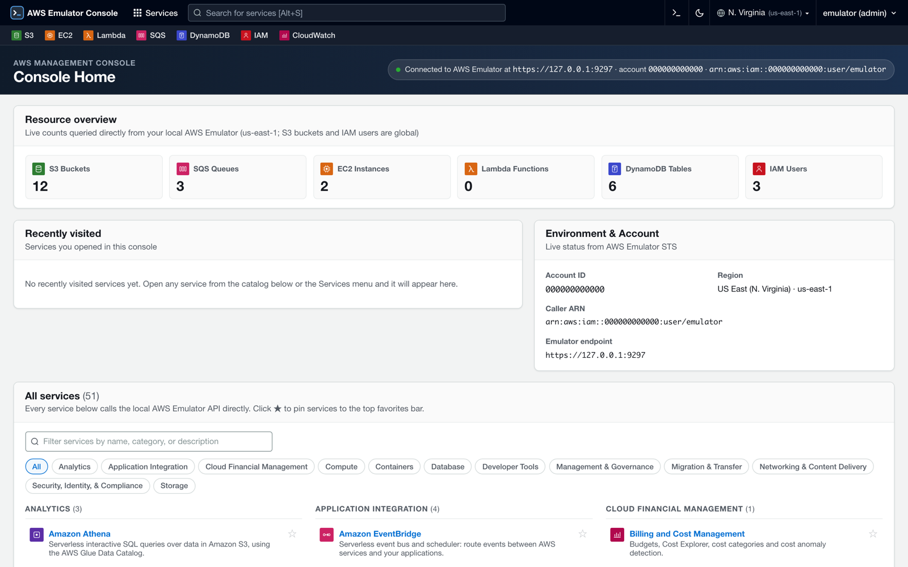
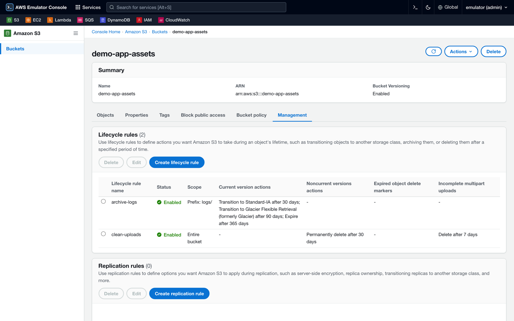
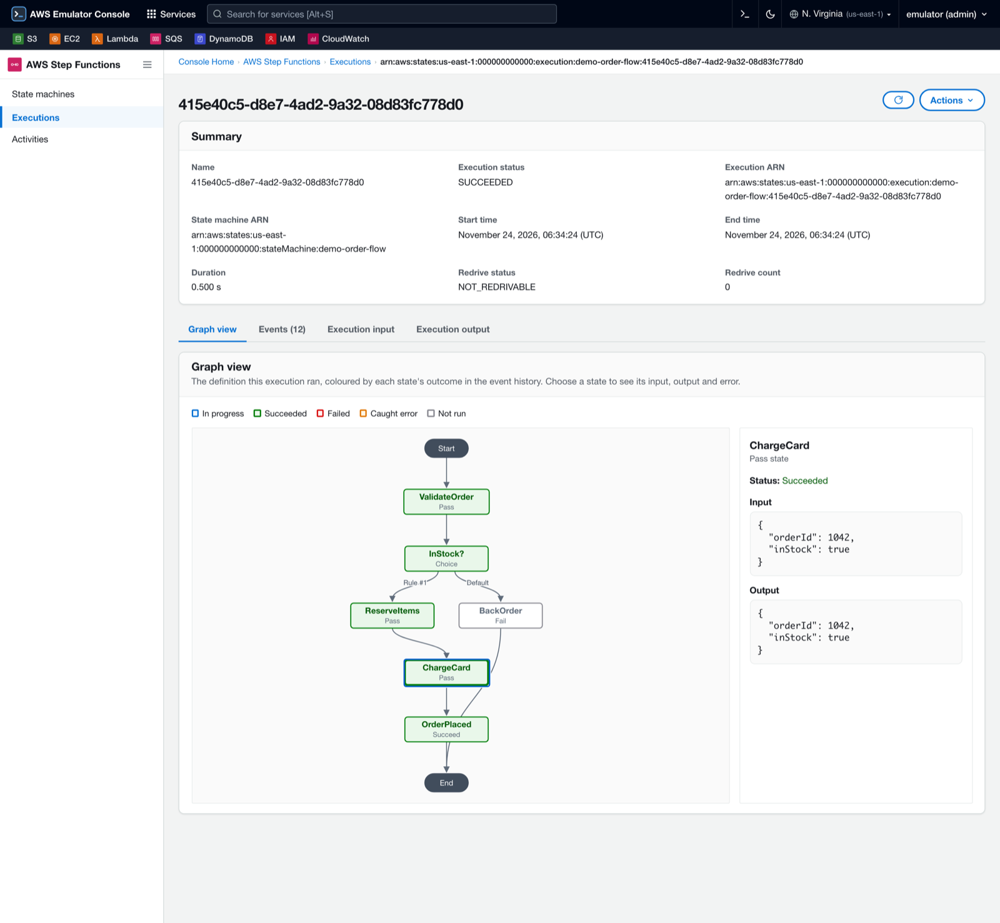

# AWS Emulator Console

A local web console for [AWS Emulator](https://github.com/aws/aws-emulator). It looks and works like the AWS Management Console, and everything on screen comes from the emulator's own API responses. It is built for learning AWS without an AWS account.

Not affiliated with or endorsed by Amazon Web Services.



| S3 bucket lifecycle rules | Step Functions execution graph |
| --- | --- |
|  |  |

What it has:

- **Console shell**: services menu and search, Region selector, CloudShell drawer, identity menu, Console Home.
- **Regions**: the top bar switches between the 17 Regions the emulator enables by default (US East (N. Virginia) us-east-1 to South America (São Paulo) sa-east-1), as on AWS. The choice is kept in a cookie. Regional pages and CloudShell work in the chosen Region; global services (IAM, Organizations, Route 53, CloudFront, S3, Billing and Cost Management, IAM Identity Center) show "Global" and use us-east-1. Opt-in Regions (af-south-1, ap-east-1 …) are not offered: the emulator treats them as not enabled for the account.
- **51 services**:
  - Compute: Amazon EC2, AWS Lambda, AWS Elastic Beanstalk
  - Containers: Amazon ECS, Amazon EKS
  - Storage: Amazon S3, Amazon S3 Glacier, Amazon EFS, AWS Backup
  - Database: Amazon DynamoDB, Amazon RDS, Amazon ElastiCache, Amazon Redshift
  - Networking & Content Delivery: VPC, Route 53, Amazon CloudFront, API Gateway
  - Security, Identity & Compliance: IAM, IAM Identity Center, Key Management Service, Secrets Manager, Certificate Manager, Cognito, Resource Access Manager, AWS WAF, Amazon GuardDuty, AWS Security Hub CSPM
  - Application Integration: Amazon SQS, Amazon SNS, Amazon EventBridge, AWS Step Functions
  - Analytics: Amazon Athena, AWS Glue, Amazon Kinesis
  - Management & Governance: CloudWatch, CloudFormation, AWS CloudTrail, AWS Config, Systems Manager, AWS Organizations, Service Quotas, X-Ray, AWS Fault Injection Service, AWS Resilience Hub, AWS Compute Optimizer, AWS Well-Architected Tool
  - Developer Tools: AWS CodeCommit, AWS CodeBuild, AWS CodePipeline
  - Migration & Transfer: AWS Database Migration Service
  - Cloud Financial Management: Billing and Cost Management
- **IAM simulator**: switch to a real IAM user or role from the emulator; every call is then checked against that identity's policies before it is sent.
- **CloudShell**: runs `aws ...` commands against the emulator in a macOS sandbox, in the Region chosen in the top bar.

Where the emulator lacks an API, the page says so and the control isn't offered.

## Run it

Needs macOS (CloudShell uses `sandbox-exec`), Docker, Node.js 22+ and the AWS CLI v2 (`brew install awscli`).

```bash
git clone <this repo> aws-emulator-console
cd aws-emulator-console
./scripts/emulator.sh start        # builds the emulator image the first time; publishes 127.0.0.1:9297 only
npm ci --ignore-scripts
npm run dev                        # http://127.0.0.1:3001
```

Open <http://127.0.0.1:3001>.

Other commands:

| Command | What it does |
| --- | --- |
| `./scripts/emulator.sh status` / `stop` | Check or stop the emulator container. Stopping wipes all emulated resources (state is in memory). |
| `eval "$(./scripts/emulator.sh env)"` | Point your own terminal's `aws` CLI at the emulator. |
| `npm run build && npm start` | Production build, served on 127.0.0.1:3001. |
| `npm test` | Unit tests (`node:test`). |
| `npm run test:e2e` | Playwright tests against the running emulator. |
| `npm run lint`, `npx tsc --noEmit` | Lint and type check. |

`EMULATOR_PORT` (default 9297) and `PORT` (default 3001) change the ports.

## Safety

This runs on a Mac that may also hold **real** AWS credentials, so:

- **Never real AWS.** The console reads keys and the CA only from `~/.aws/emulator/<port>/` and talks only to `https://127.0.0.1:<port>`. It never uses the SDK's default credential chain. `scripts/dev.mjs` removes every `AWS_*` variable from the environment before starting Next.js. E2e tests source `~/projects/aws-emulator/emulator-env.sh` before each `aws` call and stop unless the account is `000000000000`.
- **Local only.** The server binds to 127.0.0.1, and `src/proxy.ts` refuses any request whose `Host` header is not loopback (DNS rebinding). The emulator port is published on 127.0.0.1 only.
- **No shell strings.** Programs run with `execFile`/`spawn` and argument lists only.
- **CloudShell sandbox.** Only `aws ...` lines are accepted (no pipes, redirects or `$()`); commands that read local files or start other programs are refused (`src/lib/cloudshell-guard.ts`). The CLI then runs under `/usr/bin/sandbox-exec`: no reading or writing under `/Users`, `/Volumes` or `/private/var/root`, no network except `localhost:<emulator port>`, programs only from `/opt/homebrew`, `/usr/local`, `/usr/bin` and `/bin`. It runs in a fresh temp folder holding read-only copies of the emulator's config, keys and CA, with a minimal environment, no stdin, a 12 s timeout and a 2 MB output cap; the folder is removed afterwards.
- **IAM simulator, not IAM.** The emulator itself always sees the admin. When you switch identity, the console evaluates identity-based policies (explicit deny, implicit deny, wildcards, `NotAction`/`NotResource`). It cannot evaluate `Condition`s, so an Allow with a Condition is not counted and a Deny with a Condition still applies. Resource policies, permission boundaries and SCPs are not evaluated. If any policy fails to load, everything is denied.

## How to add a service

A service is data, not pages (see [DESIGN.md](DESIGN.md)):

1. Write `src/services/<id>/def.ts` exporting a `ServiceDef` (`src/console/types.ts`): resources with `list`, `columns`, and optionally `get`, `create`, `actions`, `delete`. Use only `ctx.clients.<service>` (the permission-checked clients from `src/lib/aws.ts`). `src/services/sqs/def.ts` is the reference.
2. Register it in `src/console/registry.ts` (`SERVICES`).
3. The console now has `/<id>/<resource>`, `/<id>/<resource>/create` and `/<id>/<resource>/<resource id>`, a services-menu entry and search.
4. Add an e2e test in `e2e/<id>.spec.ts` that creates a resource through the form, sees it in the list and in `aws` CLI output, opens its detail page and deletes it.

Need a screen the engine can't draw (a wizard, a browser, an editor)? Put a hand-built component in `src/services/<id>/` and a route under `src/app/<id>/...`, reusing `ServiceFrame` and the generic pages from `src/console/ui/pages.tsx`. The S3 bucket page (`src/app/s3/buckets/[bucket]/page.tsx`) is the example.

## License

MIT. See [LICENSE](LICENSE).
